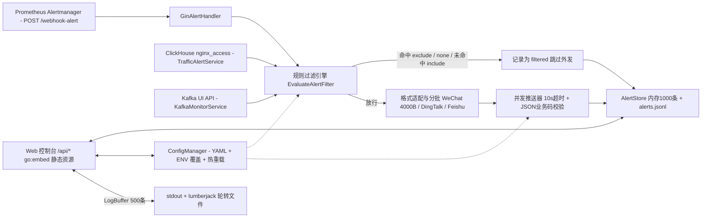

<h1 align="center">Alertmanager Webhook Notifier</h1>
<p align="center">面向运维与研发的告警路由转发中心：接收 Prometheus Alertmanager Webhook，巡检 ClickHouse 大流量与 Kafka 消费积压，并发推送至企业微信 / 钉钉 / 飞书，内置零依赖 Web 运维控制台</p>
<p align="center">
  
  
  
  
  
</p>

---

## 目录

- [1. 系统定位与架构](#1-系统定位与架构)
  - [1.1 核心处理链路](#11-核心处理链路)
  - [1.2 目录与模块职责](#12-目录与模块职责)
- [2. 部署指南](#2-部署指南)
  - [2.1 Docker Compose 标准部署（推荐）](#21-docker-compose-标准部署推荐)
  - [2.2 离线 / 无 Docker Hub 环境部署](#22-离线--无-docker-hub-环境部署)
  - [2.3 接入已有 Prometheus / Alertmanager 容器网络](#23-接入已有-prometheus--alertmanager-容器网络)
  - [2.4 Kubernetes 部署示例](#24-kubernetes-部署示例)
  - [2.5 源码 / 二进制与 Systemd 部署](#25-源码--二进制与-systemd-部署)
  - [2.6 从 v1.0 / v1.1 二进制迁移到 v1.2 Docker](#26-从-v10--v11-二进制迁移到-v12-docker)
  - [2.7 Nginx HTTPS 反向代理示例](#27-nginx-https-反向代理示例)
- [3. 通知渠道接入与消息机制](#3-通知渠道接入与消息机制)
  - [3.1 三平台接入与安全限制](#31-三平台接入与安全限制)
  - [3.2 告警级别映射、配色与时区](#32-告警级别映射配色与时区)
  - [3.3 HTTP 200 静默失败校验](#33-http-200-静默失败校验)
  - [3.4 实际推送消息格式示例](#34-实际推送消息格式示例)
- [4. 配置系统与过滤规则详解](#4-配置系统与过滤规则详解)
  - [4.1 加载优先级与热更新边界](#41-加载优先级与热更新边界)
  - [4.2 完整配置字段手册](#42-完整配置字段手册)
  - [4.3 环境变量一览表](#43-环境变量一览表)
  - [4.4 过滤规则执行顺序与真值表](#44-过滤规则执行顺序与真值表)
- [5. ClickHouse 大流量监控与 Kafka UI 巡检原理](#5-clickhouse-大流量监控与-kafka-ui-巡检原理)
  - [5.1 ClickHouse 大流量异常检测](#51-clickhouse-大流量异常检测)
  - [5.2 Kafka UI 消费者组积压监控](#52-kafka-ui-消费者组积压监控)
- [6. Web 控制台与安全认证](#6-web-控制台与安全认证)
- [7. REST API 完整参考](#7-rest-api-完整参考)
  - [7.1 公开端点与控制面端点总览](#71-公开端点与控制面端点总览)
  - [7.2 高频接口请求示例](#72-高频接口请求示例)
- [8. 日志、持久化与生产排障手册](#8-日志持久化与生产排障手册)
  - [8.1 日志与存储明细](#81-日志与存储明细)
  - [8.2 生产排障速查表](#82-生产排障速查表)
- [9. 本地开发与二次开发指南](#9-本地开发与二次开发指南)
  - [9.1 构建与测试命令](#91-构建与测试命令)
  - [9.2 扩展新的通知渠道 Checklist](#92-扩展新的通知渠道-checklist)
- [10. 更新日志与开源协议](#10-更新日志与开源协议)

---

## 1. 系统定位与架构

本项目基于 **Go 1.24 + Gin** 构建，将告警接收、自主巡检、规则过滤、多平台消息格式适配与离线 Web 运维台打包进单一静态可执行文件（通过 `go:embed` 内嵌静态资源，并内置 `time/tzdata` 避免精简容器缺时区库）：

- **三路告警输入**：Prometheus Alertmanager Webhook（`POST /webhook-alert`）、ClickHouse Nginx 大流量定时巡检、Kafka UI 消费者组积压定时巡检。
- **零配置引导与在线热更新**：支持空配置或 0 个渠道平滑启动；除监听地址和数据/日志目录外，所有通知渠道、过滤规则及巡检参数在 Web 控制台保存后立即原子落盘并热生效。
- **完整可观测闭环**：内存保留最近 1000 条告警审计（并持久化到 `alerts.jsonl`）与最近 500 条日志，同时提供各平台业务返回码（`errcode`/`code`）校验、模拟沙箱与连通性自检接口。

### 1.1 核心处理链路



### 1.2 目录与模块职责

| 路径 | 核心文件 / 包 | 职责说明 |
| :--- | :--- | :--- |
| `main.go` | `main` | 解析 `-config` 与 `ALERT_WEBHOOK_CONFIG`，初始化多路日志（`stdout` + 文件 + `LogBuffer`），注册 `web.StaticFS()` 并启动服务 |
| `config/` | `webhook_config.go`, `manager.go`, `init_webhook.go` | 配置结构体、默认值、`ALERT_WEBHOOK_*` 环境变量覆盖、校验器、通配符过滤引擎、线程安全 `ConfigManager` 与原子落盘 |
| `store/` | `alert_store.go`, `log_buffer.go` | 1000 条告警环形缓冲 + JSONL 持久化 + 24 小时时间线聚合统计；500 条日志环形缓冲与级别分类 |
| `service/` | `server_manager.go`, `api_handler.go` | Gin 路由、可选 `auth_token` 中间件、`/healthz` `/readyz`、15 个 `/api/*` 控制面端点、5 秒优雅停机 |
| `service/` | `alertmanager_handler.go`, `webhook_sender.go` | Webhook 接收、按通道并发推送、企业微信分批、10 秒 HTTP 超时、企微/钉钉/飞书业务错误码校验 |
| `service/` | `service_manager.go`, `clickhouse_service.go`, `traffic_alert_service.go`, `kafka_monitor_service.go`, `app_launcher.go` | 后台巡检生命周期管理与热重载、ClickHouse SQL 安全拼接与 15 秒超时控制、Kafka UI 消费组拉取 |
| `utils/` | `alert_formater.go`, `json_utils.go` | 东八区时间转换（带 `UTC+8` 兜底）、三平台文本/Markdown 渲染、WeChat 4000B 动态分批、返回码解析 |
| `web/` | `embed.go`, `static/index.html`, `static/css/*`, `static/js/**` | 零外部 CDN 依赖的原生 ES6 Web 控制台，编译时直接嵌入二进制 |
| 部署文件 | [Dockerfile](Dockerfile), [docker-compose.yml](docker-compose.yml), [.env.example](.env.example), [Makefile](Makefile) | 多阶段非 root Alpine 镜像、Compose 编排、环境变量模板与快捷构建脚本 |

---

## 2. 部署指南

### 2.1 Docker Compose 标准部署（推荐）

适用于可访问 Docker Hub 的常规服务器或本地环境：

```bash
# 1. 克隆仓库并进入目录
git clone https://github.com/bubua12/alert-webhook.git
cd alert-webhook

# 2. 按需复制环境变量（可选，用于注入 AUTH_TOKEN 或各渠道 Webhook URL）
cp .env.example .env

# 3. 准备宿主机持久化目录（可选；如不提前放 config.yaml，首次启动会自动生成默认配置）
mkdir -p conf data logs
cp config-example.yaml conf/config.yaml

# 4. 构建并后台启动（等价于 make docker-up）
docker compose up -d --build

# 5. 验证健康状态与日志
curl -s http://127.0.0.1:18082/healthz
docker compose logs -f
```

**两个关键工程细节：**

1. **为什么挂载 `./conf:/app/config` 目录，而不是单文件或 `./config`？**
   - 仓库根目录下的 `./config/` 是 Go 源码包目录（存放 `config/*.go`），宿主机挂载 `./conf` 可避免与源码目录混杂。
   - 若宿主机尚未创建 `config.yaml` 就直接挂载 `-v ./config.yaml:/app/config/config.yaml`，Docker 会自动建出一个同名空目录导致进程读文件失败。
   - 在 Web 控制台修改配置热保存时，后端采用「写同目录临时文件 + `fsync` + `os.Rename`」原子替换；单文件 bind mount 在部分内核下会触发 `EBUSY`/`EXDEV`（尽管代码已内置 `os.WriteFile` 降级兜底，挂载目录仍是最稳妥的做法）。
2. **Linux 非 root 挂载目录权限**：
   [Dockerfile](Dockerfile) 中默认创建并切换至 `appuser`（Alpine 下默认为 UID `100` / GID `101`）。如果宿主机通过 root 预先创建了 `./conf`、`./data`、`./logs` 且容器日志出现 `permission denied`，执行一次赋权即可：
   ```bash
   chown -R 100:101 conf data logs
   docker compose restart
   ```

### 2.2 离线 / 无 Docker Hub 环境部署

当生产服务器处于内网、无法拉取 `golang:1.24-alpine` 或 `alpine:3.21` 基础镜像时，直接在有 Go 环境的开发机静态交叉编译，再在目标服务器用 `FROM scratch` 打包运行（仅约 26MB，二进制已内嵌 Web 控制台与 `time/tzdata`）：

**第一步：在本地开发机静态编译**

```bash
# 目标机为 x86_64 Linux（若为 ARM64 服务器则改 GOARCH=arm64）
CGO_ENABLED=0 GOOS=linux GOARCH=amd64 go build -trimpath -ldflags="-s -w" -o alert-webhook .
```

**第二步：在目标服务器准备目录、CA 证书与编排文件**

> ⚠️ **必须使用 `cp -L` 解引用复制 CA 证书**：RHEL/Rocky/CentOS 的 `/etc/pki/tls/certs/ca-bundle.crt` 是软链接，直接 `COPY` 进 `FROM scratch` 会失效并导致推送企业微信/钉钉/飞书时报 HTTPS 证书错误。

```bash
mkdir -p /data/alert-webhook/{conf,data,logs}
cd /data/alert-webhook

# 上传第一步编译好的 alert-webhook 二进制到 /data/alert-webhook/alert-webhook 并赋权
chmod +x /data/alert-webhook/alert-webhook

# 复制宿主机 CA 证书（Rocky/RHEL/CentOS 路径；Debian/Ubuntu 请改用 /etc/ssl/certs/ca-certificates.crt）
cp -L /etc/pki/tls/certs/ca-bundle.crt /data/alert-webhook/ca-certificates.crt

# 写入离线 Dockerfile
cat <<'EOF' > /data/alert-webhook/Dockerfile
FROM scratch
COPY ca-certificates.crt /etc/ssl/certs/ca-certificates.crt
COPY alert-webhook /app/alert-webhook
WORKDIR /app
EXPOSE 18082
ENV TZ=Asia/Shanghai \
    ALERT_WEBHOOK_CONFIG=/app/config/config.yaml \
    ALERT_WEBHOOK_DATA_DIR=/app/data \
    ALERT_WEBHOOK_LOG_DIR=/app/logs
ENTRYPOINT ["/app/alert-webhook"]
EOF

cat <<'EOF' > /data/alert-webhook/.dockerignore
conf
data
logs
backup-*
EOF

cat <<'EOF' > /data/alert-webhook/docker-compose.yml
services:
  alert-webhook:
    build: .
    image: alert-webhook:v1.2.0
    container_name: alert-webhook
    restart: unless-stopped
    ports:
      - "18082:18082"
    environment:
      TZ: Asia/Shanghai
      ALERT_WEBHOOK_CONFIG: /app/config/config.yaml
      ALERT_WEBHOOK_DATA_DIR: /app/data
      ALERT_WEBHOOK_LOG_DIR: /app/logs
    volumes:
      - ./conf:/app/config
      - ./data:/app/data
      - ./logs:/app/logs
EOF

docker compose up -d --build
```

### 2.3 接入已有 Prometheus / Alertmanager 容器网络

如果服务器已经通过另一个 `docker-compose.yml`（例如 `prometheus-stack`）运行了 Prometheus 和 Alertmanager，可以让 `alert-webhook` 加入同一外部桥接网络，直接通过容器服务名通信，避免走宿主机公网/局域网回环：

```yaml
# 在 alert-webhook 的 docker-compose.yml 中追加网络配置
services:
  alert-webhook:
    # ... 其余配置同上 ...
    networks:
      - default
      - monitor

networks:
  monitor:
    external: true
    name: prometheus-stack_monitor   # 用 docker network ls 查看实际的 bridge 网络名
```

对应的 Alertmanager `alertmanager.yml` 配置：

```yaml
global:
  resolve_timeout: 5m

route:
  group_by: ['alertname', 'instance']
  group_wait: 30s
  group_interval: 5m
  repeat_interval: 1h
  receiver: 'webhook-notifier'

receivers:
  - name: 'webhook-notifier'
    webhook_configs:
      # 同 Docker 网络时可直接填容器名或服务名：
      - url: 'http://alert-webhook:18082/webhook-alert'
      # 若跨主机或走宿主机端口，则填写宿主机内网 IP：
      # - url: 'http://192.168.31.120:18082/webhook-alert'
        send_resolved: true
```

### 2.4 Kubernetes 部署示例

```yaml
apiVersion: v1
kind: Secret
metadata:
  name: alert-webhook-secret
  namespace: monitoring
type: Opaque
stringData:
  ALERT_WEBHOOK_AUTH_TOKEN: "replace-with-strong-token"
  ALERT_WEBHOOK_WECHAT_URL: "https://qyapi.weixin.qq.com/cgi-bin/webhook/send?key=replace-me"
---
apiVersion: v1
kind: ConfigMap
metadata:
  name: alert-webhook-config
  namespace: monitoring
data:
  config.yaml: |
    server:
      port: "0.0.0.0:18082"
      ui_enabled: true
      data_dir: "/app/data"
      log_dir: "/app/logs"
    client:
      - wechat
    filter:
      severity:
        exclude: ["info", "none"]
---
apiVersion: apps/v1
kind: Deployment
metadata:
  name: alert-webhook
  namespace: monitoring
spec:
  replicas: 1
  selector:
    matchLabels:
      app: alert-webhook
  template:
    metadata:
      labels:
        app: alert-webhook
    spec:
      containers:
        - name: alert-webhook
          image: alert-webhook:v1.2.0
          ports:
            - containerPort: 18082
          envFrom:
            - secretRef:
                name: alert-webhook-secret
          env:
            - name: TZ
              value: "Asia/Shanghai"
            - name: ALERT_WEBHOOK_CONFIG
              value: "/app/config/config.yaml"
          livenessProbe:
            httpGet:
              path: /healthz
              port: 18082
            initialDelaySeconds: 5
            periodSeconds: 15
          readinessProbe:
            httpGet:
              path: /readyz
              port: 18082
            initialDelaySeconds: 3
            periodSeconds: 10
          volumeMounts:
            - name: config
              mountPath: /app/config
            - name: data
              mountPath: /app/data
          resources:
            requests:
              cpu: 50m
              memory: 64Mi
            limits:
              cpu: 500m
              memory: 256Mi
      volumes:
        - name: config
          configMap:
            name: alert-webhook-config
        - name: data
          emptyDir: {}
---
apiVersion: v1
kind: Service
metadata:
  name: alert-webhook
  namespace: monitoring
spec:
  selector:
    app: alert-webhook
  ports:
    - name: http
      port: 18082
      targetPort: 18082
```

> 提示：在 Kubernetes 中若将 `ConfigMap` 只读挂载到 `/app/config`，环境变量覆盖仍然生效；如需从 Web 控制台持久化写回 `config.yaml`，请改用 `PersistentVolumeClaim` 挂载 `/app/config` 与 `/app/data`。

### 2.5 一键打包、脚本启停与 Systemd 部署

要求 **Go 1.24+**（修改前端静态文件无需 Node 打包，Go 编译时自动嵌入）：

```bash
# 方式一：打包开箱即用发布目录与压缩包（含二进制、start.sh/stop.sh、配置模板与 .env.example）
make package
# 若在 macOS/本地交叉打包 Linux 服务器版本：
make package-linux        # 输出 dist/alert-webhook-linux-amd64/ 与 .tar.gz
make package-linux-arm64  # 输出 dist/alert-webhook-linux-arm64/ 与 .tar.gz

# 解压或进入打包目录，按需配置 .env 后直接一键启动：
cd dist/alert-webhook-linux-amd64
cp .env.example .env      # 编辑 .env 设置 API_KEY、Webhook 地址等（不建 .env 也可直接启动）
./start.sh                # 自动读取同目录 .env、检查进程存活并输出 PID/日志路径
./stop.sh                 # 优雅停机（最长等待 10s）

# 方式二：仅在当前目录编译单个二进制
make build
./alert-webhook -config=/etc/alert-webhook/config.yaml
```

Systemd 托管示例（`/etc/systemd/system/alert-webhook.service`）：

```ini
[Unit]
Description=Alert Webhook Notifier
After=network.target

[Service]
Type=simple
User=alert-webhook
WorkingDirectory=/opt/alert-webhook
Environment=ALERT_WEBHOOK_CONFIG=/opt/alert-webhook/config.yaml
ExecStart=/opt/alert-webhook/alert-webhook
Restart=on-failure
RestartSec=5

[Install]
WantedBy=multi-user.target
```

### 2.6 从 v1.0 / v1.1 二进制迁移到 v1.2 Docker

v1.2.0 **100% 兼容** v1.0/v1.1 的 `config.yaml` 字段，迁移只需 4 步：

```bash
cd /data/alert-webhook
# 1. 停止旧进程（如有）并备份旧文件
./stop.sh 2>/dev/null || true
mkdir -p backup-v1 conf data logs
mv alert-webhook start.sh stop.sh alert-webhook.pid backup-v1/ 2>/dev/null || true

# 2. 原样保留旧版生产 config.yaml 到 conf/ 目录
cp -a config.yaml backup-v1/config.yaml
mv config.yaml conf/config.yaml

# 3. 放入仓库的 Dockerfile/.dockerignore/docker-compose.yml（或离线方式），构建并启动
docker compose up -d --build

# 4. 验证原配置已生效
curl -s http://127.0.0.1:18082/readyz
```

### 2.7 Nginx HTTPS 反向代理示例

若需将 Web 控制台暴露到公网或办公网统一域名下，强烈建议配合 Nginx TLS + `ALERT_WEBHOOK_AUTH_TOKEN` 使用：

```nginx
server {
    listen 443 ssl http2;
    server_name alert.example.com;

    ssl_certificate     /etc/nginx/ssl/alert.example.com.crt;
    ssl_certificate_key /etc/nginx/ssl/alert.example.com.key;

    location / {
        proxy_pass http://127.0.0.1:18082;
        proxy_set_header Host              $host;
        proxy_set_header X-Real-IP         $remote_addr;
        proxy_set_header X-Forwarded-For   $proxy_add_x_forwarded_for;
        proxy_set_header X-Forwarded-Proto $scheme;
    }
}
```

---

## 3. 通知渠道接入与消息机制

### 3.1 三平台接入与安全限制

| 平台 | Webhook URL 格式 | 消息格式 | 必须注意的平台规则 |
| :--- | :--- | :--- | :--- |
| **企业微信 (`wechat`)** | `https://qyapi.weixin.qq.com/cgi-bin/webhook/send?key=<key>` | `markdown` | 单条消息上限 **4096 字节**，程序按 **4000 字节**安全上限自动拆分多条告警并间隔 `200ms` 顺序发送（若单条告警本身超 4000 字节，仍会单独尝试投递）。企业微信群机器人官方限频约 20 条/分钟。 |
| **钉钉 (`dingtalk`)** | `https://oapi.dingtalk.com/robot/send?access_token=<token>` | `markdown` | 钉钉机器人强制要求至少启用一种安全设置。**本程序当前仅传 Webhook URL（未实现加签逻辑）**，请在钉钉群机器人安全设置中选择 **「自定义关键字」**（例如填入 `Prometheus` 或 `告警`）或 **「IP 地址（段）」白名单**；否则会返回 `errcode=310000`。 |
| **飞书 (`feishu`)** | `https://open.feishu.cn/open-apis/bot/v2/hook/<token>` | `text` | 与钉钉同理，若飞书机器人启用了安全校验，请配置 **「自定义关键词」**（如 `Prometheus`、`告警`）或 **「IP 白名单」**（目前暂未实现签名校验）。 |

> **多 Webhook 目标并发推送与向后兼容**：三个内置渠道（`wechat`、`dingtalk`、`feishu`）均支持配置**多个 Webhook 地址**（通过 `notifiers.<name>.webhooks` 列表声明对象 `{ name, url, enabled }` 或 URL 字符串，也可通过环境变量传入逗号分隔多地址）。告警触发时会向每个渠道下所有**已启用且有效**的 Webhook 目标并发推送，并独立记录各目标的投递回执与耗时；同时 **100% 向后兼容**旧版单地址 `notifiers.<name>.webhook_url` 配置。

### 3.2 告警级别映射、配色与时区

- **时间统一转换**：无论上游 Alertmanager 发送的是 UTC 还是其他时区时间，所有格式器均调用 `utils.GetShanghaiLocation()` 转换为 `Asia/Shanghai`（`2006-01-02 15:04:05`）；若运行环境缺失系统 tzdata，自动兜底使用固定 `UTC+8`（`CST`），不会 panic。
- **企业微信标题颜色**：当同一批次包含多条告警时，取本批最高优先级级别（`emergency > critical > warning > info`）决定标题颜色。

| 原始 `severity` 标签 | 渲染展示级别 | 企业微信颜色 | 钉钉颜色 |
| :--- | :--- | :--- | :--- |
| `emergency` | `P0` | `red` | `#FF0000` |
| `critical` | `P1` | `red` | `#FF7F0E` |
| `warning` | `P2` | `warning` | `#FFD700` |
| `info` | `P3` | `comment` | `comment` |
| 其他值（如 `high`） | 原样输出 | `black` | `black` |

### 3.3 HTTP 200 静默失败校验

企业微信、钉钉和飞书在发生参数错误、密钥失效、关键字未命中或限流时，**经常依然返回 HTTP 200 状态码**并在 JSON 响应体中携带错误码。本服务在 `service/webhook_sender.go` 与 `utils/json_utils.go` 中设置了 **10 秒**请求超时（启动连通性自检为 5 秒），并对响应体执行严格校验：

- **企业微信 / 钉钉**：解析 JSON，若 `errcode != nil && errcode != 0` 判定为发送失败。
- **飞书**：解析 JSON，若 `code != 0`、`StatusCode != 0` 或 `errcode != 0` 均判定为发送失败。
- **自定义 Webhook 代理**：若下游返回 HTTP 2xx 且响应体不是 JSON（例如纯文本 `"ok"`），默认视为发送成功。

### 3.4 实际推送消息格式示例

以下文本严格对应 [utils/alert_formater.go](utils/alert_formater.go)、[service/traffic_alert_service.go](service/traffic_alert_service.go) 与 [service/kafka_monitor_service.go](service/kafka_monitor_service.go) 的实际渲染输出：

**1. 触发中告警（以企业微信 Markdown 渲染效果为例）**

```text
🔥 Prometheus 告警通知
请关注告警信息，相关人员请注意
> 状态: 告警中
> 告警名称: HighCPUUsage
> 级别: P1
> 实例: 10.0.8.120:9100
> 摘要: 节点 CPU 使用率持续高于 90%
> 描述: 最近 5 分钟 CPU idle 低于 10%，请检查负载进程
> 触发时间: 2026-11-24 14:30:00
```

**2. ClickHouse 大流量告警（`alertname="异常流量告警"`、`severity="warning"`）**

```text
🔥 Prometheus 告警通知
请关注告警信息，相关人员请注意
> 状态: 告警中
> 告警名称: 异常流量告警
> 级别: P2
> 实例: api.example.com
> 摘要: 域名 api.example.com 路径 /export 发现大流量异常
> 描述: 在过去 10 分钟内，流量统计信息如下
	• 总请求数: 125
	• 大请求数量: 8 (阈值: 1.0 MB)
	• 大响应数量: 12 (阈值: 5.0 MB)
	• 平均请求大小: 2048.50 字节
	• 平均响应大小: 8192000.00 字节
	• 最大请求大小: 4194304 字节
	• 最大响应大小: 20971520 字节
最近的大请求示例:
1. 14:25:32 POST /api/export (请求:4194304字节, 响应:20971520字节, 耗时:1.500s)
> 触发时间: 2026-11-24 14:30:00
```

**3. Kafka 消费积压告警（`alertname="Kafka消费者组积压告警"`、`severity="warning"`）**

```text
🔥 Prometheus 告警通知
请关注告警信息，相关人员请注意
> 状态: 告警中
> 告警名称: Kafka消费者组积压告警
> 级别: P2
> 实例: order-group-01
> 摘要: Kafka消费者组 order-group-01 积压告警
> 描述: 消费者组积压信息:
	• 消费者组ID: order-group-01
	• 当前积压量: 299390
	• 告警阈值: 100000
	• 成员数量: 0
	• 关联主题数: 1
	• 组状态: EMPTY
	• 协调器: 172.25.101.24:9092
> 触发时间: 2026-11-24 14:30:00
```

**4. 已恢复通知（`status="resolved"`）**

```text
♻ Prometheus 告警恢复
> 状态: 已恢复
> 告警名称: HighCPUUsage
> 恢复时间: 2026-11-24 14:45:00
```

---

## 4. 配置系统与过滤规则详解

完整 YAML 模板见 [config-example.yaml](config-example.yaml)，Kafka 专项示例见 [config-kafka-example.yaml](config-kafka-example.yaml)，环境变量模板见 [.env.example](.env.example)。

### 4.1 加载优先级与热更新边界

1. **配置文件路径解析优先级**：`命令行 -config 参数` > `环境变量 ALERT_WEBHOOK_CONFIG` > `./config.yaml`。如果目标文件不存在，程序会自动创建默认配置并正常启动。
2. **`.env` 自动加载与优先级**：程序启动时会自动查找并加载 `.env`（顺序：`ALERT_WEBHOOK_ENV_FILE` > 当前目录 `./.env` > 可执行文件同目录 `.env`），且**绝不覆盖**操作系统中已存在的环境变量。字段值生效优先级：`系统环境变量` > `.env` > `config.yaml` > `程序内置默认值`。
3. **环境变量启用渠道的特殊规则**：设置 `ALERT_WEBHOOK_WECHAT_URL` / `ALERT_WEBHOOK_WECHAT_URLS`、`ALERT_WEBHOOK_DINGTALK_URL` / `ALERT_WEBHOOK_DINGTALK_URLS` 或 `ALERT_WEBHOOK_FEISHU_URL` / `ALERT_WEBHOOK_FEISHU_URLS`（均支持逗号分隔多个 URL）时，始终会覆盖内存中的 `notifiers.<client>` 目标列表（`webhooks` 与主地址 `webhook_url`）；但**只有当 `config.yaml` 中的 `client` 列表原本为空（`[]`）时**，程序才会自动把该渠道加入 `client` 启用列表；若 `config.yaml` 中已显式配置了 `client: [wechat]`，则不会擅自启用其他渠道。
4. **热更新行为**：在 Web 控制台保存配置、调用 `PUT /api/config` / `PUT /api/config/yaml` 或 `POST /api/config/reload` 后，除 `server.port`、`server.data_dir`、`server.log_dir` 三项变更会返回 `restart_required: true` 提示需要重启进程/容器外，通知渠道、过滤规则、ClickHouse 与 Kafka 监控任务均立即**无重启热生效**（旧巡检任务会被优雅 `Stop()` 后按新配置重建）。

### 4.2 完整配置字段手册

| 配置路径 | 类型 | 默认值 | 校验规则 / 说明 | 支持热更新 |
| :--- | :--- | :--- | :--- | :--- |
| `server.port` | `string` | `"0.0.0.0:18082"` | 需符合 `host:port` 或 `:port`（端口 `1-65535`） | 否（需重启） |
| `server.ui_enabled` | `bool` | `true` | 为 `false` 时隐藏 Web 控制台与静态资源，仅提供 API 与 Webhook | 是 |
| `server.auth_token` | `string` | `""` | 非空时开启 `/api/*` Token 认证 | 是 |
| `server.data_dir` | `string` | `"./data"` | `alerts.jsonl` 持久化目录 | 否（需重启） |
| `server.log_dir` | `string` | `"./logs"` | `alter-server.log` 轮转日志目录 | 否（需重启） |
| `client` | `string[]` | `[]` | 启用的渠道列表，支持 `"wechat"` / `"dingtalk"` / `"feishu"` | 是 |
| `notifiers.<name>.webhooks` | `WebhookTarget[] \| string[]` | `[]` | 多 Webhook 目标列表（适用于 `wechat` / `dingtalk` / `feishu`）。每项支持 `{ name, url, enabled }` 对象（`name` 可选备注名；`enabled` 可选，默认 `true`）或 URL 字符串简写；含 `xxxxxx` 等占位符将被识别为未配置 | 是 |
| `notifiers.<name>.webhook_url` | `string` | `""` | **兼容旧版单地址字段**：对应渠道单个 Webhook URL（含 `xxxxxx` 等占位符将被识别为未配置）。100% 向后兼容；若与 `webhooks` 同时配置，将自动合并去重 | 是 |
| `filter.alert_name.include` | `string[]` | `[]` | 告警名称白名单，支持 `*` 通配符 | 是 |
| `filter.alert_name.exclude` | `string[]` | `[]` | 告警名称黑名单，优先级高于 `include` | 是 |
| `filter.severity.include` | `string[]` | `[]` | 告警级别白名单，支持 `*` 通配符 | 是 |
| `filter.severity.exclude` | `string[]` | `["info", "none"]` | 告警级别黑名单，优先级高于 `include` | 是 |
| `clickhouse.host` | `string` | `"localhost"` | 启用 `traffic_alert` 时不能为空 | 是 |
| `clickhouse.port` | `int` | `9000` | ClickHouse Native TCP 端口（`1-65535`） | 是 |
| `clickhouse.database` | `string` | `"nginxlogs"` | 严格正则校验 `^[a-zA-Z0-9_]+$` 防 SQL 注入 | 是 |
| `clickhouse.username` | `string` | `"default"` | ClickHouse 用户名 | 是 |
| `clickhouse.password` | `string` | `""` | ClickHouse 密码 | 是 |
| `traffic_alert.enabled` | `bool` | `false` | 是否启用 ClickHouse 大流量巡检 | 是 |
| `traffic_alert.check_interval` | `int` | `300` | 巡检周期（秒），小于 `5` 时运行时自动钳制为 `5` 秒 | 是 |
| `traffic_alert.request_size_threshold` | `int64` | `1048576` (1MB) | 单次请求大小阈值（字节） | 是 |
| `traffic_alert.response_size_threshold` | `int64` | `5242880` (5MB) | 单次响应大小阈值（字节） | 是 |
| `traffic_alert.time_window` | `int` | `10` | SQL 回溯统计时间窗口（分钟，需 `> 0`） | 是 |
| `traffic_alert.count_threshold` | `int` | `5` | 窗口内大请求或大响应触发告警次数阈值（需 `> 0`） | 是 |
| `kafka_monitor.enabled` | `bool` | `false` | 是否启用 Kafka UI 消费者组积压巡检 | 是 |
| `kafka_monitor.kafka_ui_url` | `string` | `"http://localhost:8090"` | Kafka UI 基础地址（合法 http/https URL，不含路径） | 是 |
| `kafka_monitor.cluster_name` | `string` | `"local-kafka"` | Kafka UI 中的集群名称 | 是 |
| `kafka_monitor.check_interval` | `int` | `60` | 巡检周期（秒），小于 `5` 时自动钳制为 `5` 秒 | 是 |
| `kafka_monitor.consumer_lag_threshold` | `int64` | `100000` | 触发告警的消费积压消息数阈值（严格 `>` 触发，配置需 `>= 0`） | 是 |
| `kafka_monitor.monitored_groups` | `string[]` | `[]` | 指定监控的消费组 ID 列表，为空则监控全部 | 是 |
| `kafka_monitor.ignored_groups` | `string[]` | `[]` | 忽略的消费组 ID 列表，优先级高于 `monitored_groups` | 是 |

**多 Webhook 配置写法示例（与旧版 `webhook_url` 完全向后兼容）：**

```yaml
notifiers:
  wechat:
    webhooks:
      - name: "运维主群"
        url: "https://qyapi.weixin.qq.com/cgi-bin/webhook/send?key=key-1"
        enabled: true
      - name: "值班备用群"
        url: "https://qyapi.weixin.qq.com/cgi-bin/webhook/send?key=key-2"
        enabled: false
      - "https://qyapi.weixin.qq.com/cgi-bin/webhook/send?key=key-3"  # 字符串简写（默认 enabled: true）
  dingtalk:
    webhook_url: "https://oapi.dingtalk.com/robot/send?access_token=legacy-single-token"  # 旧版单地址写法仍完全支持
```

### 4.3 环境变量一览表

| 环境变量 | 容器默认值 / 示例 | 说明 |
| :--- | :--- | :--- |
| `ALERT_WEBHOOK_CONFIG` | `/app/config/config.yaml` | 配置文件路径（低于 `-config` 参数） |
| `ALERT_WEBHOOK_ENV_FILE` | `""` | 指定 `.env` 文件路径（未设置时自动读取 `./.env` 或程序同目录 `.env`） |
| `API_KEY` | `""` | Web 控制台独立登录页密钥与 `/api/*` 访问密钥（优先级高于 `ALERT_WEBHOOK_API_KEY` 与 `ALERT_WEBHOOK_AUTH_TOKEN`） |
| `ALERT_WEBHOOK_API_KEY` | `""` | `API_KEY` 别名，用于开启 Web 登录页与 `/api/*` 鉴权 |
| `ALERT_WEBHOOK_PORT` | `0.0.0.0:18082` | 覆盖 `server.port` |
| `ALERT_WEBHOOK_AUTH_TOKEN` | `""` | 兼容旧版变量名：覆盖 `server.auth_token`（优先级低于 `API_KEY`） |
| `ALERT_WEBHOOK_DATA_DIR` | `/app/data` | 覆盖 `server.data_dir` |
| `ALERT_WEBHOOK_LOG_DIR` | `/app/logs` | 覆盖 `server.log_dir` |
| `ALERT_WEBHOOK_WECHAT_URL` | `""` | 覆盖企业微信 Webhook URL；支持单个地址或英文逗号 `,` 分隔的多地址（自动去重） |
| `ALERT_WEBHOOK_WECHAT_URLS` | `""` | `ALERT_WEBHOOK_WECHAT_URL` 复数别名（同样支持逗号分隔多地址；同时设置时按顺序合并去重） |
| `ALERT_WEBHOOK_DINGTALK_URL` | `""` | 覆盖钉钉 Webhook URL；支持单个地址或英文逗号 `,` 分隔的多地址（自动去重） |
| `ALERT_WEBHOOK_DINGTALK_URLS` | `""` | `ALERT_WEBHOOK_DINGTALK_URL` 复数别名（同样支持逗号分隔多地址；同时设置时按顺序合并去重） |
| `ALERT_WEBHOOK_FEISHU_URL` | `""` | 覆盖飞书 Webhook URL；支持单个地址或英文逗号 `,` 分隔的多地址（自动去重） |
| `ALERT_WEBHOOK_FEISHU_URLS` | `""` | `ALERT_WEBHOOK_FEISHU_URL` 复数别名（同样支持逗号分隔多地址；同时设置时按顺序合并去重） |
| `ALERT_WEBHOOK_CLICKHOUSE_HOST` | `""` | 覆盖 `clickhouse.host` |
| `ALERT_WEBHOOK_CLICKHOUSE_PORT` | `""` | 覆盖 `clickhouse.port`（`1-65535`） |
| `ALERT_WEBHOOK_CLICKHOUSE_DB` | `""` | 覆盖 `clickhouse.database` |
| `ALERT_WEBHOOK_CLICKHOUSE_USER` | `""` | 覆盖 `clickhouse.username` |
| `ALERT_WEBHOOK_CLICKHOUSE_PASSWORD` | `""` | 覆盖 `clickhouse.password` |
| `ALERT_WEBHOOK_TRAFFIC_ENABLED` | `""` | 覆盖 `traffic_alert.enabled`（`true`/`false`） |
| `ALERT_WEBHOOK_KAFKA_ENABLED` | `""` | 覆盖 `kafka_monitor.enabled`（`true`/`false`） |
| `ALERT_WEBHOOK_KAFKA_UI_URL` | `""` | 覆盖 `kafka_monitor.kafka_ui_url` |
| `ALERT_WEBHOOK_KAFKA_CLUSTER` | `""` | 覆盖 `kafka_monitor.cluster_name` |
| `ALERT_WEBHOOK_HOST_PORT` | `18082` | 仅 `docker-compose.yml` 使用：宿主机映射端口 |
| `TZ` | `Asia/Shanghai` | 容器与默认本地时间时区 |
| `GIN_MODE` | `release` | 设为 `debug` 可开启 Gin 详细路由调试日志 |

### 4.4 过滤规则执行顺序与真值表

所有告警按以下 **5 步短路顺序**判定（`*` 支持任意 UTF-8 多段通配，如 `High*CPU*`、`*Test*`）：

1. **内置无效级别丢弃**：`strings.EqualFold(severity, "none")` 直接拦截（在 Webhook 与模拟器入口生效）。
2. **`alert_name.exclude`**：命中任一规则 -> **拦截**。
3. **`alert_name.include`**：若列表非空，未命中任何规则 -> **拦截**；列表为空则跳过。
4. **`severity.exclude`**：命中任一规则 -> **拦截**。
5. **`severity.include`**：若列表非空，未命中任何规则 -> **拦截**；否则 **放行**。

> ⚠️ **白名单常见踩坑**：ClickHouse 大流量告警固定以 `alertname="异常流量告警"`、`severity="warning"` 进入同一套过滤引擎；Kafka 积压告警固定以 `alertname="Kafka消费者组积压告警"`、`severity="warning"` 进入过滤引擎。如果你开启了 `filter.alert_name.include` 白名单，**请务必把 `"异常流量告警"` 或 `"Kafka消费者组积压告警"` 也加入白名单**，否则会被当成非白名单告警拦截。

假设配置如下：`alert_name.include: ["High*", "异常流量告警"]`、`alert_name.exclude: ["*Test*"]`、`severity.exclude: ["info", "none"]`：

| `alertname` | `severity` | 结果 | 命中原因 |
| :--- | :--- | :--- | :--- |
| `HighCPUUsage` | `critical` | ✅ 放行 | 命中 `High*`，未命中任何 `exclude` |
| `HighTestAlert` | `critical` | ❌ 拦截 | 第 2 步先命中 `alert_name.exclude: *Test*` |
| `DiskFull` | `critical` | ❌ 拦截 | 第 3 步未命中 `alert_name.include` |
| `HighMemory` | `info` | ❌ 拦截 | 第 4 步命中 `severity.exclude: info` |
| `异常流量告警` | `warning` | ✅ 放行 | 命中 `alert_name.include` 且通过 `severity` 检查 |

---

## 5. ClickHouse 大流量监控与 Kafka UI 巡检原理

### 5.1 ClickHouse 大流量异常检测

开启 `traffic_alert.enabled: true` 后，服务启动时会向 `<clickhouse.database>.nginx_access` 执行 `SELECT count(*) ... WHERE timestamp >= now() - INTERVAL 1 MINUTE` 验证连接（连不上时仅报错并降级禁用大流量巡检，不影响主服务启动）。定时任务每 `check_interval` 秒执行以下聚合查询（15 秒查询超时）：

```sql
SELECT
    domain,
    top_path,
    count(*) AS total_count,
    avg(request_length) AS avg_request_size,
    avg(response_length) AS avg_response_size,
    max(request_length) AS max_request_size,
    max(response_length) AS max_response_size,
    countIf(request_length > ?) AS large_request_count,
    countIf(response_length > ?) AS large_response_count
FROM `<database>`.nginx_access
WHERE timestamp >= now() - INTERVAL ? MINUTE
GROUP BY domain, top_path
HAVING large_request_count >= ? OR large_response_count >= ?
ORDER BY total_count DESC
LIMIT 100
```

命中异常的 `(domain, top_path)` 会再取最近 5 条超大请求/响应（在消息正文中展示前 3 条示例）。**调优建议**：建议保持 `check_interval`（秒）与 `time_window * 60` 接近（例如 `time_window: 10` 分钟搭配 `check_interval: 300` 或 `600` 秒），避免同一个窗口内的异常在短时间内重复告警。

<details>
<summary>点击展开 ClickHouse 建表 SQL (nginxlogs.nginx_access)</summary>

```sql
CREATE DATABASE IF NOT EXISTS nginxlogs;

CREATE TABLE nginxlogs.nginx_access
(
    `timestamp` DateTime64(3, 'Asia/Shanghai'),
    `server_ip` String,
    `domain` String,
    `request_method` String,
    `status` Int32,
    `top_path` String,
    `path` String,
    `query` String,
    `protocol` String,
    `referer` String,
    `upstreamhost` String,
    `responsetime` Float32,
    `upstreamtime` Float32,
    `duration` Float32,
    `request_length` Int32,
    `response_length` Int32,
    `client_ip` String,
    `client_latitude` Float32,
    `client_longitude` Float32,
    `remote_user` String,
    `remote_ip` String,
    `xff` String,
    `client_city` String,
    `client_region` String,
    `client_country` String,
    `http_user_agent` String,
    `client_browser_family` String,
    `client_browser_major` String,
    `client_os_family` String,
    `client_os_major` String,
    `client_device_brand` String,
    `client_device_model` String,
    `createdtime` DateTime64(3, 'Asia/Shanghai')
)
ENGINE = MergeTree
PARTITION BY toYYYYMMDD(timestamp)
PRIMARY KEY (timestamp, server_ip, status, top_path, domain)
TTL toDateTime(timestamp) + toIntervalDay(30)
SETTINGS index_granularity = 8192;
```

</details>

### 5.2 Kafka UI 消费者组积压监控

开启 `kafka_monitor.enabled: true` 后，服务每 `check_interval` 秒请求一次 Kafka UI 分页接口（10 秒 HTTP 超时、单轮巡检 15 秒总超时，读取前 100 个消费组）：

```text
GET <kafka_ui_url>/api/clusters/<cluster_name>/consumer-groups/paged?page=1&perPage=100&search=
```

- **筛选顺序**：先跳过 `ignored_groups` 中的组；若 `monitored_groups` 非空则只检查名单内的组；当 `consumerLag > consumer_lag_threshold`（严格大于）时触发告警。
- **在线探查**：在 Web 控制台「配置中心 → Kafka 监控」点击 **测试 Kafka UI 连接**，可直接列出当前集群下所有消费组与实时 Lag，并支持一键加入监控名单或忽略名单。

---

## 6. Web 控制台与安全认证

服务启动后访问 `http://<server-ip>:18082` 即可打开控制台（右上角支持浅色 / 深色主题与 10 秒自动刷新开关）：

| 页面 | 核心功能 |
| :--- | :--- |
| **监控总览** | 4 项核心 KPI、24 小时趋势堆叠图、级别分布环形图、渠道健康条（展示多目标就绪数量与平均延迟）、Webhook 接收地址一键复制、快速测试弹窗（含各目标回执）与 ClickHouse/Kafka 一键立即检测 |
| **告警记录** | 按状态 (`firing`/`resolved`)、投递结果 (`sent`/`partial`/`failed`/`filtered`)、来源 (`alertmanager`/`traffic`/`kafka`/`test`)、级别与关键词（含目标名称）分页搜索；列表展示各目标投递状态徽章，点击任意行滑出详情抽屉查看全量 Labels、Annotations、过滤原因以及每个渠道与具体目标（`target`）的投递回执、耗时和响应体；支持导出 JSON 与清空 |
| **配置中心** | 5 个子标签覆盖通知渠道（每个渠道支持添加/删除多个 Webhook、自定义备注名、独立启用/停用开关、密钥显隐切换及未保存前的单目标测试与「测试全部」）、过滤规则（标签编辑 + 在线规则测试器）、流量监控（`B/KB/MB/GB` 单位换算 + ClickHouse 探针）、Kafka 监控（消费组拉取）、服务与原生 YAML 编辑器（导入/下载 + 自动生成 `alertmanager.yml` 片段） |
| **调试沙箱** | 4 套内置告警场景模板（展示各渠道已启用目标数），可一键 **Dry Run 预览**三平台渲染结果（不污染统计）或 **真实发送测试**并查看每个目标（`target`）的独立投递回执与返回码 |
| **运行日志** | 查看内存缓冲的最近 500 条运行日志，支持 `ALL`/`INFO`/`WARN`/`ERROR` 筛选、关键字查找、自动滚动与一键复制 |

**关于 `API_KEY` 独立登录页与接口鉴权：**
- 一旦在 `.env` 中设置了 `API_KEY`（或通过 `ALERT_WEBHOOK_API_KEY`、`ALERT_WEBHOOK_AUTH_TOKEN`、`config.yaml` 的 `server.auth_token` 设置非空密钥），访问 Web 控制台会先进入**独立登录页面**（主控制台隐藏不渲染），用户输入正确 `API_KEY` 通过 `POST /api/auth/login` 验证后方可进入控制台；右上角支持点击「退出登录」注销本地凭证。
- 所有受保护的 `/api/*` 请求均经过 `AuthMiddleware`（基于 `crypto/subtle.ConstantTimeCompare` 常量时间比对），支持 `X-API-Key: <key>`、`X-API-Token: <key>` 或 `Authorization: Bearer <key>`，否则返回 `401 {"error":"unauthorized","auth_required":true}` 并由前端自动退回登录页。
- `POST /webhook-alert`、`GET /healthz`、`GET /readyz`、`GET /api/auth/status`、`POST /api/auth/login` 以及静态页面资源保持公开访问，不阻断 Alertmanager 推告警或健康探针。

---

## 7. REST API 完整参考

### 7.1 公开端点与控制面端点总览

| 端点 | 鉴权 | 说明 / 返回状态 |
| :--- | :--- | :--- |
| `POST /webhook-alert` | 无 | 接收 Alertmanager Webhook：`200`（全部发送成功、全部被过滤、无告警或 0 渠道仅记账）、`400`（JSON 无效）、`500`（部分或全部渠道推送失败） |
| `GET /healthz` | 无 | 存活探针：返回 `{"status":"ok","uptime_seconds":...,"version":"1.2.0"}` |
| `GET /readyz` | 无 | 就绪探针：返回 `{"status":"ready","config_loaded":true,"enabled_clients":[...]}` |
| `GET /api/auth/status` | 无 | 查询控制台登录保护状态：`{"auth_required":bool,"authenticated":bool}` |
| `POST /api/auth/login` | 无 | 登录校验：`{"api_key":"..."}`，匹配返回 `200`，失败返回 `401` |
| `GET /api/overview` | 可选 | 返回版本、启动时间、`setup_complete`、聚合统计、`timeline`（24h）、巡检服务状态及最近 8 条告警 |
| `GET /api/alerts` | 可选 | 分页查询：`page`、`page_size`、`status`、`delivery_state`、`source`、`severity`、`q` |
| `DELETE /api/alerts` | 可选 | 清空告警历史（内存 + `alerts.jsonl`） |
| `GET /api/config` | 可选 | 返回生效 `config` JSON、配置文件路径、原始 `yaml`、`warnings` 及生效环境变量列表 `env_overrides` |
| `PUT /api/config` | 可选 | 提交 `AppConfig` JSON，校验、原子落盘并热重载；返回 `{ ok, config, yaml, warnings, restart_required }` |
| `PUT /api/config/yaml` | 可选 | 提交 `{"yaml":"..."}` 原始 YAML，校验、原子落盘并热重载 |
| `POST /api/config/reload` | 可选 | 从磁盘重新加载 `config.yaml` 并热重载后台服务 |
| `POST /api/test/notifier` | 可选 | 多目标测连：支持单目标 `{"client":"wechat\|dingtalk\|feishu\|all","webhook_url":"可选临时地址","target":"可选目标名称"}` 或批量列表 `{"client":"wechat\|dingtalk\|feishu","webhooks":[{"name":"...","url":"...","enabled":true}]}`；省略 `webhook_url`/`webhooks` 时测试对应渠道（或 `all` 全部已启用渠道）下所有已启用目标，结果按目标逐条返回（含 `target` 字段） |
| `POST /api/test/clickhouse` | 可选 | 测试 ClickHouse 连接并返回延迟与最近 1 分钟日志数（可传临时 `ClickHouseConfig`） |
| `POST /api/test/kafka` | 可选 | 测试 Kafka UI 连接并返回消费组列表（可传临时 `KafkaMonitorConfig`） |
| `POST /api/filter/test` | 可选 | 测规则：`{"alert_name":"...","severity":"...","filter":{可选临时规则}}`，返回 `FilterDecision` |
| `POST /api/simulate` | 可选 | 沙箱模拟：`{"status","alert_name","severity","instance","summary","description","labels","send":bool,"clients":[]}` |
| `POST /api/services/traffic/check` | 可选 | 立即触发一次 ClickHouse 大流量检测 |
| `POST /api/services/kafka/check` | 可选 | 立即触发一次 Kafka 消费组积压检测 |
| `GET /api/logs` | 可选 | 查询运行日志：`level`（`INFO`/`WARN`/`ERROR`）、`q`、`limit`（最大 500） |

### 7.2 高频接口请求示例

**1. 模拟 Alertmanager 推送一条触发告警**

```bash
curl -X POST http://127.0.0.1:18082/webhook-alert \
  -H "Content-Type: application/json" \
  -d '{
    "receiver": "webhook-notifier",
    "status": "firing",
    "alerts": [{
      "status": "firing",
      "labels": {
        "alertname": "HighCPUUsage",
        "severity": "critical",
        "instance": "10.0.8.120:9100"
      },
      "annotations": {
        "summary": "节点 CPU 使用率过高",
        "description": "节点 10.0.8.120 CPU 连续 5 分钟超过 90%"
      }
    }]
  }'
```

**2. 带 Token 鉴权测试临时通知渠道（无需先保存配置）**

```bash
# 单目标测试（也可传 "webhooks": [{"name":"运维主群","url":"...","enabled":true}, ...] 批量测试多目标）
curl -s -X POST http://127.0.0.1:18082/api/test/notifier \
  -H "Content-Type: application/json" \
  -H "X-API-Token: your-token" \
  -d '{
    "client": "wechat",
    "target": "运维主群",
    "webhook_url": "https://qyapi.weixin.qq.com/cgi-bin/webhook/send?key=your-key"
  }'
```

示例返回（若企微返回 `errcode != 0`，`success` 会准确置为 `false` 并带上 `error`）：

```json
{
  "ok": true,
  "results": [
    {
      "client": "wechat",
      "target": "运维主群",
      "success": true,
      "status_code": 200,
      "duration_ms": 142,
      "batches": 1,
      "response": "{\"errcode\":0,\"errmsg\":\"ok\"}"
    }
  ]
}
```

**3. 在线测试过滤规则**

```bash
curl -s -X POST http://127.0.0.1:18082/api/filter/test \
  -H "Content-Type: application/json" \
  -d '{"alert_name":"HighMemoryUsage","severity":"warning"}'
```

示例返回：

```json
{
  "allowed": true,
  "reason": "通过所有过滤规则"
}
```

**4. 在 Ansible/CI 中修改磁盘配置后触发无重启热重载**

```bash
curl -s -X POST http://127.0.0.1:18082/api/config/reload \
  -H "X-API-Token: your-token"
```

---

## 8. 日志、持久化与生产排障手册

### 8.1 日志与存储明细

- **三路日志输出**（[main.go](main.go)）：`io.MultiWriter` 同时输出到 `os.Stdout`（供 `docker logs` / `journalctl` 采集）、`<log_dir>/alter-server.log`（`lumberjack` 轮转：单文件最大 `1MB`、最多保留 `5` 个备份、保留 `7` 天、自动 `gzip` 压缩）以及内存 `LogBuffer`（最近 `500` 条，供 Web 控制台查看）。
- **告警审计持久化**（[store/alert_store.go](store/alert_store.go)）：每条进入系统或由后台巡检产生的告警均写入内存环形缓冲（容量 `1000` 条）并追加至 `<data_dir>/alerts.jsonl`；服务重启时自动从 `alerts.jsonl` 恢复最近 1000 条记录。

### 8.2 生产排障速查表

| 现象 / 日志关键字 | 根本原因 | 解决方案 |
| :--- | :--- | :--- |
| 启动日志 `dial tcp ...:9000: connect: no route to host` 或 `connection refused` | 配置中启用了 `traffic_alert`，但 ClickHouse 宿主机/跨机器地址不可达，或容器未连通目标网络 | 服务已自动降级禁用大流量巡检，不影响 Webhook 主链路。在「配置中心 → 流量监控」修改正确地址（同机容器避免填 `localhost`，应填宿主机内网 IP 或加入同网络）后点击「测试 ClickHouse 连接」并保存热生效 |
| Linux 容器启动报错 `permission denied`（无法写入 `/app/config`、`/app/data` 或 `/app/logs`） | 宿主机目录属主为 `root`，而镜像以非 root 用户 `appuser`（UID `100` / GID `101`）运行 | 在宿主机执行 `chown -R 100:101 conf data logs && docker compose restart` |
| 保存配置时报错 `device or resource busy` (`EBUSY`) | 挂载方式用了单文件 `./config.yaml:/app/config/config.yaml`，阻塞原子重命名 | 改为目录挂载 `./conf:/app/config`，并保证配置文件放在 `./conf/config.yaml` |
| 钉钉推送失败，返回 `errcode=310000` | 钉钉机器人开启了加签或自定义关键字/IP 限制，未匹配关键字或出口 IP 不在白名单 | 在钉钉机器人安全设置中添加关键字 `Prometheus` 或 `告警`，或将服务器出口 IP 加入白名单 |
| 企业微信返回 `errcode=93000` 或飞书返回 `code=19021` | Webhook Key/Token 无效、机器人已被移出群聊，或飞书未匹配安全关键字 | 在群设置重新复制机器人 Webhook URL，到控制台「通知渠道」点击 **测试连通性** 验证通过后再保存 |
| 告警在「告警记录」显示 `filtered`，三平台未收到 | 被 `filter` 规则拦截、`severity` 为 `none`，或开启 `alert_name.include` 白名单后漏配了 `异常流量告警`/`Kafka消费者组积压告警` | 打开该条告警的详情抽屉查看 `filter_reason` 字段，并在「配置中心 → 过滤规则」用在线测试器修正规则 |
| 修改 `server.port`、`data_dir` 或 `log_dir` 后控制台提示需要重启 | HTTP 监听端口与日志/数据句柄在进程启动时初始化，不支持运行时动态重绑端口 | 执行 `docker compose restart` 或重启二进制进程使新端口/目录生效 |
| 内网服务器执行 `docker compose up --build` 卡在拉取 `golang:1.24-alpine` | 宿主机无法访问公网 `registry-1.docker.io` | 按 [2.2 离线 / 无 Docker Hub 环境部署](#22-离线--无-docker-hub-环境部署) 在开发机静态编译后以 `FROM scratch` 离线构建 |

---

## 9. 本地开发与二次开发指南

### 9.1 构建与测试命令

```bash
# 运行全部单元测试（含竞态检测，推荐每次改动后执行）
make test-race
# 等价于：go test -race -v ./...

# 静态检查
go vet ./...

# 前端原生 JS 语法校验（无需 npm install）
node --check web/static/js/*.js web/static/js/views/*.js

# 本地构建与运行
make build
make run
```

### 9.2 扩展新的通知渠道 Checklist

如需新增第 4 个平台（例如 Slack / Email / 通用 Webhook），按以下清单顺序修改即可：

1. [config/webhook_config.go](config/webhook_config.go)：在 `SupportedClients` 与 `DefaultAppConfig()` 中注册新渠道标识（如 `"slack"`）。
2. [config/manager.go](config/manager.go)：在 `applyEnvOverrides` 中按需补充对应的 `ALERT_WEBHOOK_<NAME>_URL` 环境变量支持。
3. [utils/alert_formater.go](utils/alert_formater.go)：新增对应的消息格式渲染函数（复用 `GetShanghaiLocation()` 与 `MapSeverity()`）。
4. [utils/json_utils.go](utils/json_utils.go)：在 `ValidateWebhookResponse` 中补充新平台的 JSON 错误码校验规则。
5. [service/webhook_sender.go](service/webhook_sender.go)：在 `formatMessageForClient` 与 `testNotifierClientWithHTTP` 中添加消息结构体序列化与测连探针；若有长度限制需分批发送，在 `deliverToClient` 中参照企业微信分支实现。
6. 前端控制台（[web/static/js/views/config.js](web/static/js/views/config.js)、[web/static/js/views/dashboard.js](web/static/js/views/dashboard.js)、[web/static/js/views/simulator.js](web/static/js/views/simulator.js)）：补充渠道元数据卡片、健康度展示项与沙箱预览 Tab，然后重新 `go build` 即可嵌入生效。

---

## 10. 更新日志与开源协议

### 更新日志

- **v1.2.0**
  - 新增零外部 CDN 依赖的内置 Web 控制台（监控总览、告警审计抽屉、可视化配置中心与热更新、调试沙箱、实时运行日志，支持浅色/深色主题切换）。
  - 新增全渠道（企业微信 / 钉钉 / 飞书）多 Webhook 并发推送支持：支持备注名、单目标独立启停、`webhooks` 列表与逗号分隔环境变量配置，并逐目标记录投递回执与延迟统计，100% 向后兼容旧版 `webhook_url`。
  - 新增零依赖 `.env` 原生自动加载与独立 `API_KEY` 登录页鉴权（支持 `GET /api/auth/status`、`POST /api/auth/login` 与 `X-API-Key` 请求头），未认证时完全隐藏控制台主界面，Webhook 与探针端点不受影响。
  - 新增 `/healthz`、`/readyz` 探针与全量 `/api/*` REST 控制面接口，支持零配置启动与配置原子落盘热生效。
  - 新增多阶段非 root [Dockerfile](Dockerfile)、[docker-compose.yml](docker-compose.yml)、[.env.example](.env.example)、[Makefile](Makefile) 多平台开箱即用打包（`package` / `package-linux` / `package-linux-arm64`）、优化后的 `scripts/start.sh` / `scripts/stop.sh` 及 GitHub Actions 自动 Release 流水线。
  - 修复 `config` 包 `init()` 副作用导致的 `go test` 冲突、并发推送竞态、缺少 HTTP 超时与 HTTP 200 业务码漏检、无 `tzdata` 环境下时区加载隐患、ClickHouse 硬编码库名与 `defer rows.Close()` 致命退出风险、网络报错日志可能泄露 Webhook 密钥的问题，并实现标准输出+轮转文件+内存缓冲三路日志及 5 秒优雅停机。
- **v1.1.0 (2025-12-05)**：新增基于 Kafka UI API 的消费者组积压监控。
- **v1.0.1 (2025-09-16)**：新增基于 ClickHouse 的 Nginx 大流量异常告警。
- **v1.0.0-bugfix (2025-09-03)**：新增告警过滤规则与企业微信长消息自动分批。
- **v1.0.0**：初始版本发布，支持企业微信、钉钉、飞书推送。

### 开源协议

本项目基于 [MIT License](LICENSE) 开源。
